# S-band patch antenna for a 1U CubeSat

A right-hand circularly polarized patch antenna for a 2.4 GHz downlink. This repo holds the two cut-corner designs, the three size versions planned for the first order, and the dual-feed designs as a supplement. Each one has its KiCad board, its Gerbers and its Ansys HFSS results.

**Status: simulation only. Nothing has been built or measured yet.**

Author: Gabriel Irazabal

## Contents

1. [Requirements](#1-requirements)
2. [How everything was simulated](#2-how-everything-was-simulated)
3. [Cut corner, 1.5 mm](#3-cut-corner-15-mm)
4. [Cut corner, 3 mm (stacked)](#4-cut-corner-3-mm-stacked)
5. [The three sizes for the first order](#5-the-three-sizes-for-the-first-order)
6. [Supplementary: dual feed](#6-supplementary-dual-feed)
7. [How to check this work](#7-how-to-check-this-work)
8. [What has not been verified](#8-what-has-not-been-verified)

## 1. Requirements

| Requirement | Target |
| --- | --- |
| Frequency | 2.4 GHz band |
| Signal bandwidth | 20 MHz or less |
| Gain | 6.5 dBi or more (ideally 7 or more) |
| Beamwidth | half-power beamwidth 60° or wider |
| Polarization | right-hand circular |
| Impedance | 50 Ω |
| Power handling | 3 W or more |
| Environment | −40 to +85 °C |
| Direction | transmit and receive |
| Match bandwidth | return loss 10 dB or more across the full 20 MHz channel |
| Connector | SMA |

The designs are centred on 2.425 GHz, with the channel taken as 2.415 to 2.435 GHz.

## 2. How everything was simulated

| Item | Value |
| --- | --- |
| Tool | Ansys HFSS (Electronics Desktop Student 2025 R2) |
| Board material | JLCPCB PTFE, ZYF255DA: Dk 2.55, loss tangent 0.0018 |
| Board | 60 × 60 mm, 1.524 mm thick, 35 µm copper |
| Mounting | board flat on a 100 × 100 mm metal face, which stands in for the satellite panel |
| Feed | 0.5 mm pin through the board, 50 Ω lumped port |
| Mesh | refined to about 40,000 tetrahedra |
| Far field | RHCP and LHCP gain and axial ratio straight ahead, and gain against angle at 2.425 GHz |

In the plots, match is shown as S11. S11 is return loss with a minus sign, so "S11 of −10 dB or lower" is the same as "return loss of 10 dB or more".

## 3. Cut corner, 1.5 mm

One board. A square patch with two opposite corners clipped, fed by one pin. The clipped corners are what make it circularly polarized.

Folder: [`1_cut_corner_1.5mm`](1_cut_corner_1.5mm)

| Front | Back |
| --- | --- |
| 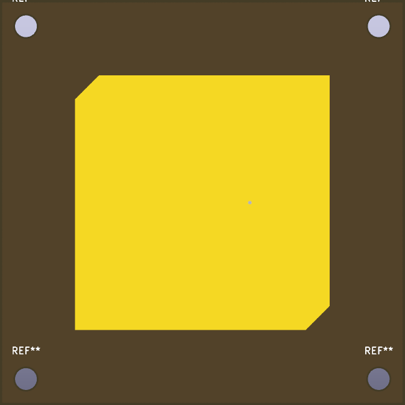 | 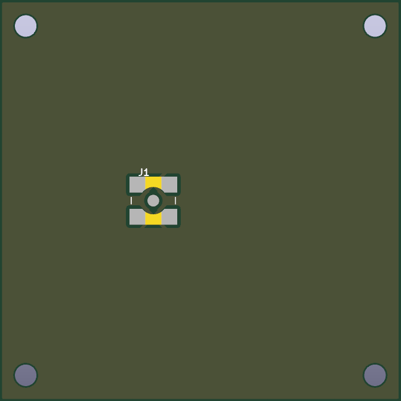 |

### Dimensions

| Item | Value |
| --- | --- |
| Board | 60 × 60 × 1.524 mm |
| Patch | 37.52 mm square, centred |
| Clipped corners | top-left and bottom-right (seen from the front), 3.50 mm along each edge |
| Feed | plated via, 0.5 mm hole, 7.00 mm to the right of the patch centre |
| Ground | whole back of the board |
| Connector | surface-mount SMA on the back (Würth 60312102114405), centre pad on the feed via |
| Solder mask | none on the front |
| Mounting holes | four M3, 4 mm in from each edge |

### Ansys HFSS results

| Requirement | Result | Meets it |
| --- | --- | --- |
| Frequency: 2.4 GHz band | best polarization at 2.425 GHz | yes |
| Signal bandwidth 20 MHz | return loss above 10 dB from 2.400 to 2.466 GHz (66 MHz) | yes |
| Gain 6.5 dBi or more | 7.08 to 7.24 dBic across the channel | yes |
| Beamwidth 60° or wider | 72° and 73° in the two cuts | yes |
| Right-hand circular | RHCP is 32 dB above LHCP at 2.425 GHz | yes |
| 50 Ω | best match −31.8 dB at 2.4455 GHz | yes |
| Return loss 10 dB over the channel | worst point in the channel 15.5 dB | yes |

Other figures: directivity 7.97 dBi, radiation efficiency 87 %.

**The known weak point is polarization at the channel edges.** The axial ratio is 0.43 dB at the centre and 4.14 dB at the edges, and it stays under 3 dB over 16 MHz. An axial ratio of 4.14 dB costs about 0.23 dB of signal to a perfectly circular ground antenna. The gain figures above already include that.

| Match | Axial ratio |
| --- | --- |
| 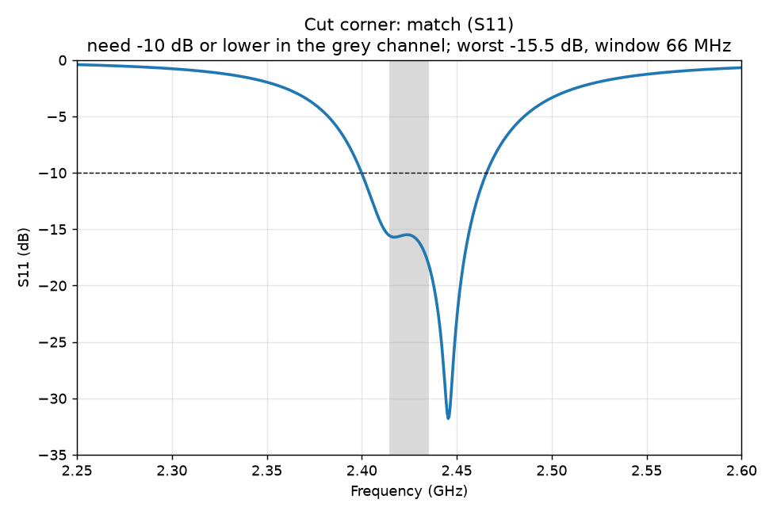 | 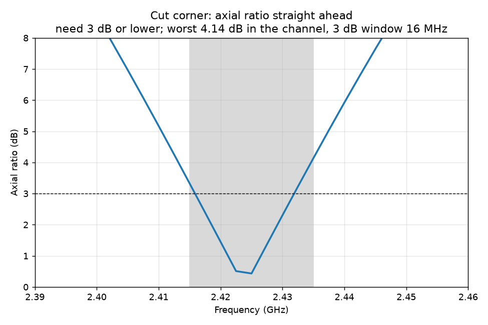 |

| Gain | Pattern |
| --- | --- |
| 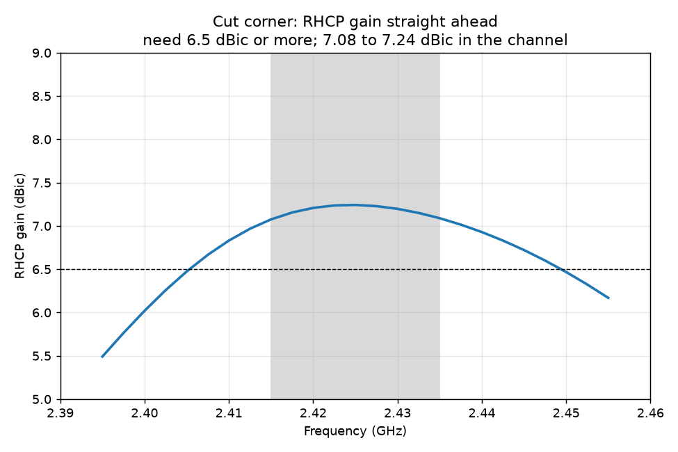 | 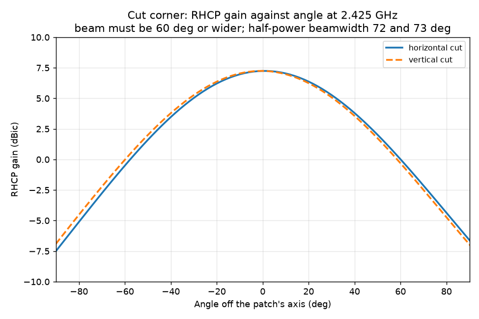 |

### Files

| What | Where |
| --- | --- |
| KiCad project | [`1_cut_corner_1.5mm/kicad`](1_cut_corner_1.5mm/kicad) |
| Gerbers for JLCPCB | [`1_cut_corner_1.5mm/gerbers/Cutcorner_antenna.zip`](1_cut_corner_1.5mm/gerbers/Cutcorner_antenna.zip) |
| Ansys project and raw results | [`1_cut_corner_1.5mm/ansys`](1_cut_corner_1.5mm/ansys) |

## 4. Cut corner, 3 mm (stacked)

Folder: [`2_cut_corner_3mm_stacked`](2_cut_corner_3mm_stacked)

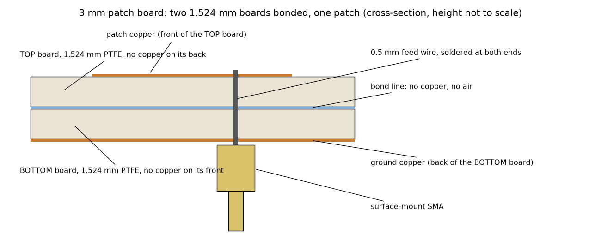

| TOP board, front | BOTTOM board, back |
| --- | --- |
| 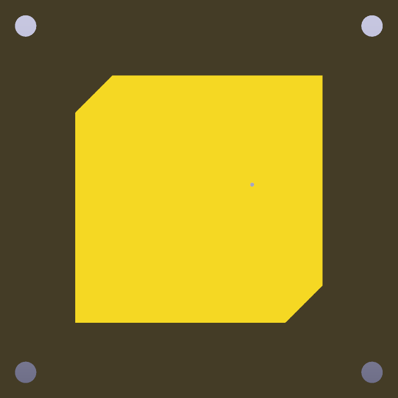 | 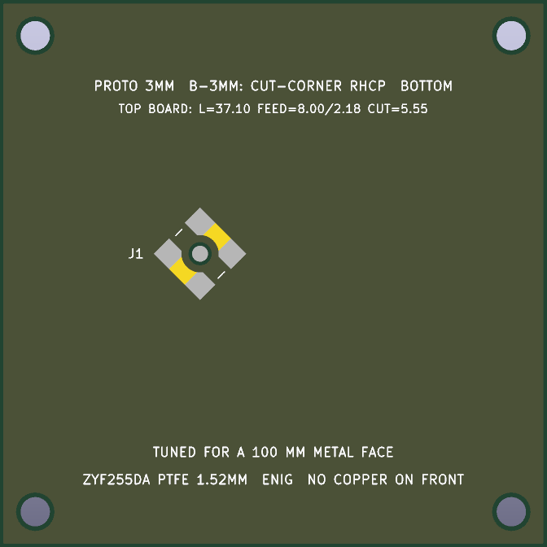 |

### Dimensions

| Item | Value |
| --- | --- |
| Boards | two, each 60 × 60 × 1.524 mm, giving 3.05 mm of PTFE between patch and ground |
| Patch (on the TOP board) | 37.10 mm square, centred |
| Clipped corners | top-left and bottom-right, 5.55 mm along each edge |
| Feed | 0.6 mm hole through both boards, 8.00 mm to the right of the patch centre and 2.18 mm up |
| Ground (on the BOTTOM board) | whole back |
| Connector | the same SMA, on the back of the BOTTOM board |
| Copper on the two glued faces | none |

The feed sits 2.18 mm off the centre line on purpose. A pin through 3 mm of board adds inductance, and the sideways offset cancels it.

### How it goes together

1. Glue the TOP board onto the BOTTOM board with a thin, even layer of adhesive, using the four M3 holes to line them up. There must be no air between them.
2. Solder the SMA to the back of the BOTTOM board.
3. Pass a 0.5 mm wire through the feed hole in both boards. Solder it to the SMA centre pad at the back and to the patch at the front, and trim it flush.

The wire is needed because the plating inside each board's hole does not connect across the glue layer.

### Ansys HFSS results

| Requirement | Result | Meets it |
| --- | --- | --- |
| Frequency: 2.4 GHz band | best polarization at 2.425 GHz | yes |
| Signal bandwidth 20 MHz | return loss above 10 dB from 2.356 to 2.487 GHz (131 MHz) | yes |
| Gain 6.5 dBi or more | 7.61 to 7.67 dBic across the channel | yes |
| Beamwidth 60° or wider | 73° in both cuts | yes |
| Right-hand circular | RHCP is 33 dB above LHCP at 2.425 GHz | yes |
| 50 Ω | best match −38.6 dB at 2.394 GHz | yes |
| Return loss 10 dB over the channel | worst point in the channel 19.1 dB | yes |

Other figures: directivity 7.96 dBi, radiation efficiency 95 %. The axial ratio is 0.38 dB at the centre and 2.17 dB at the channel edges, and stays under 3 dB over 32 MHz.

| Match | Axial ratio |
| --- | --- |
| 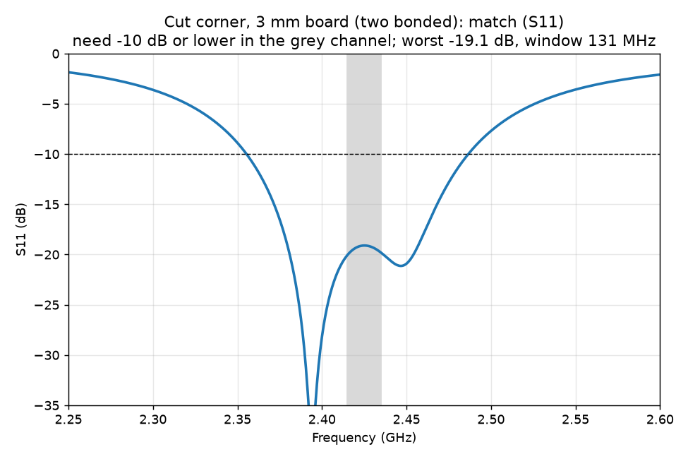 | 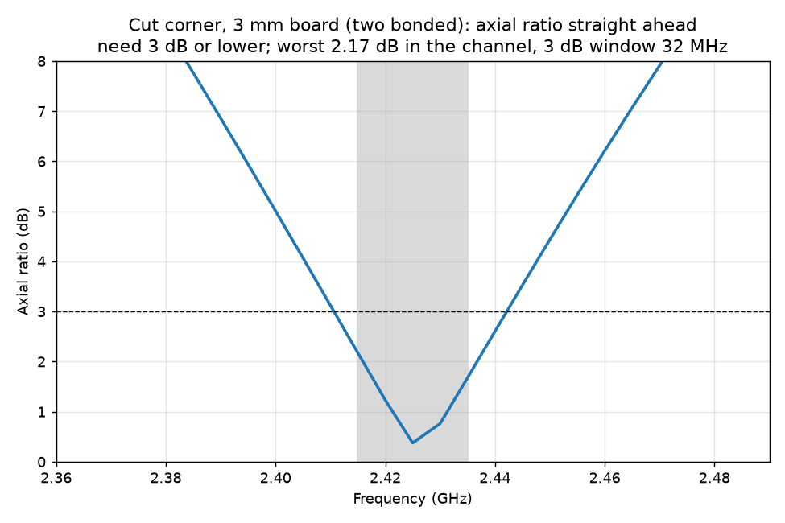 |

| Gain | Pattern |
| --- | --- |
| 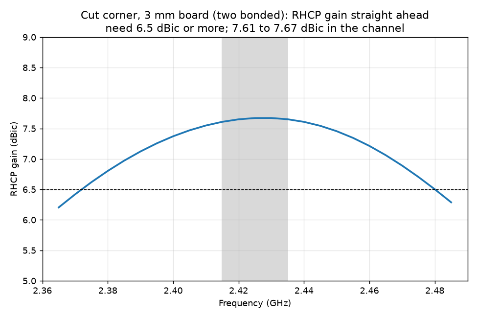 | 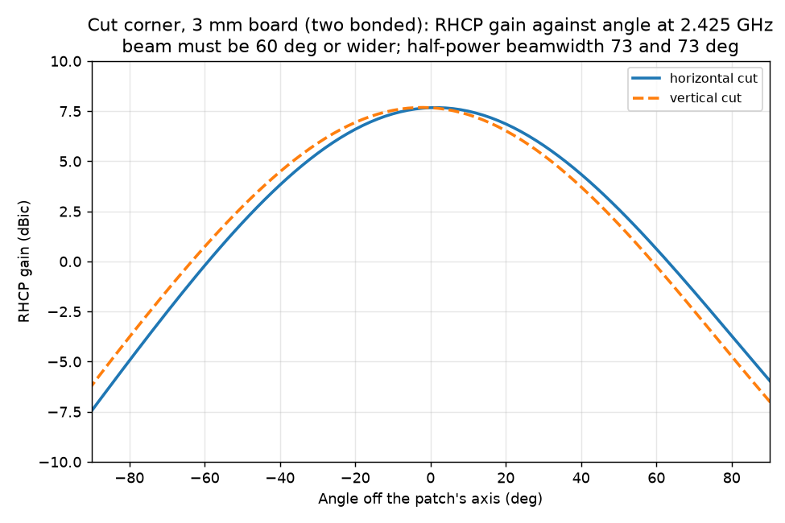 |

### Thin against thick

| | Cut corner, 1.5 mm | Cut corner, 3 mm |
| --- | --- | --- |
| RHCP gain in the channel | 7.08 to 7.24 dBic | 7.61 to 7.67 dBic |
| Worst return loss in the channel | 15.5 dB | 19.1 dB |
| Match bandwidth | 66 MHz | 131 MHz |
| Axial ratio at the channel edges | 4.14 dB | 2.17 dB |
| Bandwidth with axial ratio under 3 dB | 16 MHz | 32 MHz |
| Efficiency | 87 % | 95 % |
| Build | one board | two boards, a glue joint and a feed wire |

**The weak point of the 3 mm version is the glue joint.** In simulation, a 0.05 mm film of air between the boards raises the worst axial ratio in the channel from 2.2 to 6.5 dB.

### Files

| What | Where |
| --- | --- |
| KiCad projects, TOP and BOTTOM | [`2_cut_corner_3mm_stacked/kicad`](2_cut_corner_3mm_stacked/kicad) |
| Gerbers for JLCPCB | [`2_cut_corner_3mm_stacked/gerbers`](2_cut_corner_3mm_stacked/gerbers) |
| Ansys project and raw results | [`2_cut_corner_3mm_stacked/ansys`](2_cut_corner_3mm_stacked/ansys) |

## 5. The three sizes for the first order

The plan for the first order is the 1.5 mm cut corner in three sizes: the design size, 0.3 mm smaller and 0.3 mm larger.

Folder: [`3_three_sizes`](3_three_sizes) (the design size is in [`1_cut_corner_1.5mm`](1_cut_corner_1.5mm))

### Why

A patch antenna's frequency is set by the patch size and the board it sits on, and a factory cannot make either exactly as drawn. The expected errors are:

| What varies | By how much | Frequency shift |
| --- | --- | --- |
| Dk of the PTFE | 2.55 ± 0.04 (laminate datasheet) | about ±18 MHz |
| Board thickness | ±10 % (JLCPCB) | about ±9 MHz |
| Etched patch size | about ±0.05 mm | about ±3 MHz |

Together that is roughly ±20 MHz, which is as wide as the channel. The Dk figure comes from HFSS runs of this board with Dk set to 2.52 and 2.58, and the patch-size figure from the three sizes below. The thickness figure is from a separate check in a second solver.

### What changed

Only the side of the patch. The corner cuts, the feed position, the board and everything else are identical. A smaller patch resonates higher and a larger one lower.

| Version | Patch side | Best polarization at | Best match at | Shift from the design size |
| --- | --- | --- | --- | --- |
| Smaller | 37.22 mm | 2.4425 GHz | 2.4630 GHz | +17.5 MHz |
| Design size | 37.52 mm | 2.4250 GHz | 2.4455 GHz | 0 |
| Larger | 37.82 mm | 2.4050 GHz | 2.4280 GHz | −17.5 to −20 MHz |

So the three are about 19 MHz apart, or about 62 MHz per millimetre of patch side. The far-field sweep is in 2.5 MHz steps, which is why the two shifts are not exactly equal.

### How they are used

All three are made in the same batch, so they share the same material and thickness errors. Each is measured on a network analyzer, and the one that lands closest to 2.425 GHz is the one that flies. If the factory makes everything about 20 MHz low, that is the smaller one; if about 20 MHz high, the larger one.

### Files

| What | Where |
| --- | --- |
| KiCad projects | [`3_three_sizes/kicad`](3_three_sizes/kicad) |
| Gerbers for JLCPCB | [`3_three_sizes/gerbers`](3_three_sizes/gerbers) |
| Ansys projects and raw results | [`3_three_sizes/ansys`](3_three_sizes/ansys) |

## 6. Supplementary: dual feed

The other way to make a patch circularly polarized. A plain square patch gets two feed pins, one on each axis, driven a quarter cycle apart by an external 90° coupler. It is not the plan for this satellite, because the radio board has one S-band connector and no coupler, but it was designed and simulated as the alternative.

Folder: [`supplementary_dual_feed`](supplementary_dual_feed)

| Front | Back |
| --- | --- |
| 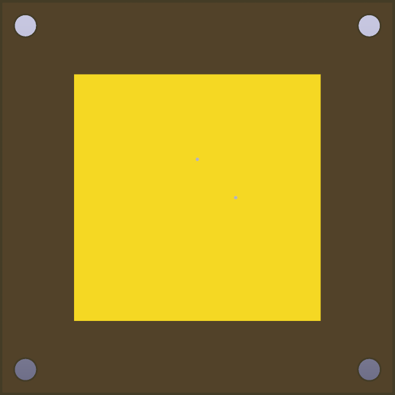 | 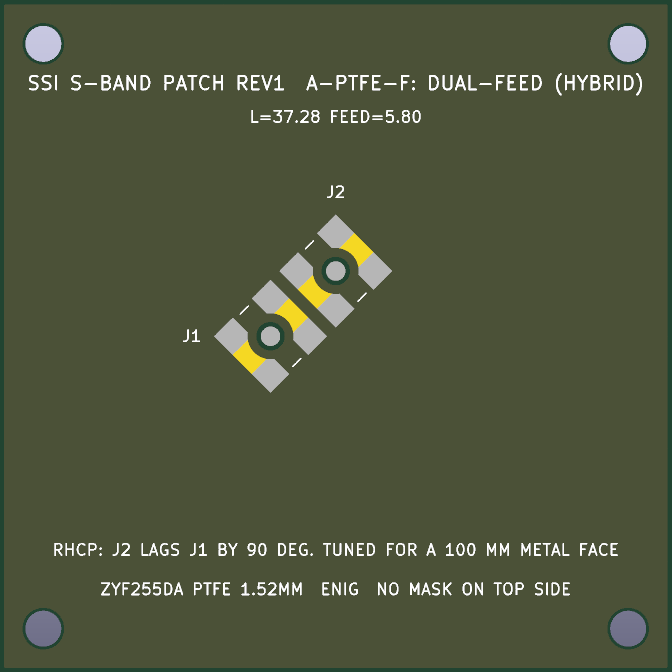 |

### Dimensions

| | Dual feed, 1.5 mm | Dual feed, 3 mm (stacked) |
| --- | --- | --- |
| Patch | 37.28 mm square | 36.39 mm square |
| Clipped corners | none | none |
| Feeds | 5.80 mm right of centre (J1) and 5.80 mm above centre (J2) | 6.70 mm right of centre (J1) and 6.70 mm above centre (J2) |
| Connectors | two SMAs | two SMAs |
| Build | one board | TOP and BOTTOM boards glued, as in section 4 |

It is right-hand circular when J2 lags J1 by 90°.

### Ansys HFSS results

| | Dual feed, 1.5 mm | Dual feed, 3 mm |
| --- | --- | --- |
| RHCP gain in the channel, at the patch | 7.16 to 7.36 dBic | 7.67 to 7.72 dBic |
| RHCP gain after a typical coupler | 6.75 to 6.96 dBic | 7.26 to 7.32 dBic |
| Worst return loss in the channel | 13.6 dB | 16.4 dB |
| Match bandwidth | 32 MHz | 63 MHz |
| Axial ratio, perfect coupler | 0.11 dB | 0.28 dB |
| Axial ratio, typical coupler | 0.79 dB | 0.94 dB |
| Isolation between the two feeds | 46 dB | 36 dB |
| Half-power beamwidth | 72° and 73° | 73° |
| Radiation efficiency | 87 % | 95 % |

"Typical coupler" means one that is off by 0.5 dB and 3° and loses 0.4 dB. The coupler itself was not modelled.

### Compared with the cut corner

| | Cut corner | Dual feed |
| --- | --- | --- |
| Polarization | good at the centre, weaker at the channel edges | good across the whole channel |
| Extra parts | none | a 90° coupler, a load, a second cable and a second connector |
| Gain | higher | about 0.3 to 0.4 dB lower, because of the coupler |
| Match bandwidth | wider | half as wide |

### Files

| What | 1.5 mm | 3 mm |
| --- | --- | --- |
| KiCad | [`kicad`](supplementary_dual_feed/1.5mm/kicad) | [`kicad`](supplementary_dual_feed/3mm_stacked/kicad) |
| Gerbers | [`gerbers`](supplementary_dual_feed/1.5mm/gerbers) | [`gerbers`](supplementary_dual_feed/3mm_stacked/gerbers) |
| Ansys project and raw results | [`ansys`](supplementary_dual_feed/1.5mm/ansys) | [`ansys`](supplementary_dual_feed/3mm_stacked/ansys) |
| Plots | [`plots`](supplementary_dual_feed/1.5mm/plots) | [`plots`](supplementary_dual_feed/3mm_stacked/plots) |

## 7. How to check this work

Each `ansys` folder holds:

| File | What it is |
| --- | --- |
| `*.aedt` | the Ansys Electronics Desktop project. Open it to see the model, materials and setup, and re-solve it |
| `summary.txt` | the headline numbers from that run |
| `sparams.csv` | S11 against frequency |
| `farfield_boresight.csv` | RHCP and LHCP gain and axial ratio against frequency, straight ahead |
| `pattern_f0.csv` | gain against angle at 2.425 GHz |
| `convergence.txt` | the mesh refinement passes |

`summary.txt` flags the axial ratio against a limit of 3 dB. That is a common target and is not one of the requirements in section 1.

Suggested checks:

1. **Dimensions.** Open a KiCad board and measure the patch, the corner cuts and the feed position against the tables above. Then open the matching `.aedt` and confirm the model has the same numbers.
2. **Materials.** In the `.aedt`, the substrate should be Dk 2.55, loss tangent 0.0018, 1.524 mm (3.048 mm for the stacked designs).
3. **Polarization hand.** The clipped corners are top-left and bottom-right seen from the front, with the feed on the right. That combination gives right-hand circular polarization. `summary.txt` reports RHCP well above LHCP.
4. **Results.** Compare the tables in this README with `summary.txt`, or re-plot from the CSV files.
5. **Gerbers.** Open a zip in any Gerber viewer and confirm it shows the same patch as the KiCad board.

## 8. What has not been verified

- **Nothing has been built or measured.** A network analyzer measurement of the first boards is the real test.
- **Power handling (3 W) and temperature (−40 to +85 °C)** have not been simulated or tested.
- **The real mounting.** Every result assumes a clean 100 mm metal face behind the board, with nothing else near the patch.
- **The SMA connector** is not in these models. In a separate run it moved the 1.5 mm cut corner about 3 MHz lower.
- **The coupler** for the dual feed is assumed, not modelled.
- **The carrier frequency** is taken as 2.425 GHz.
